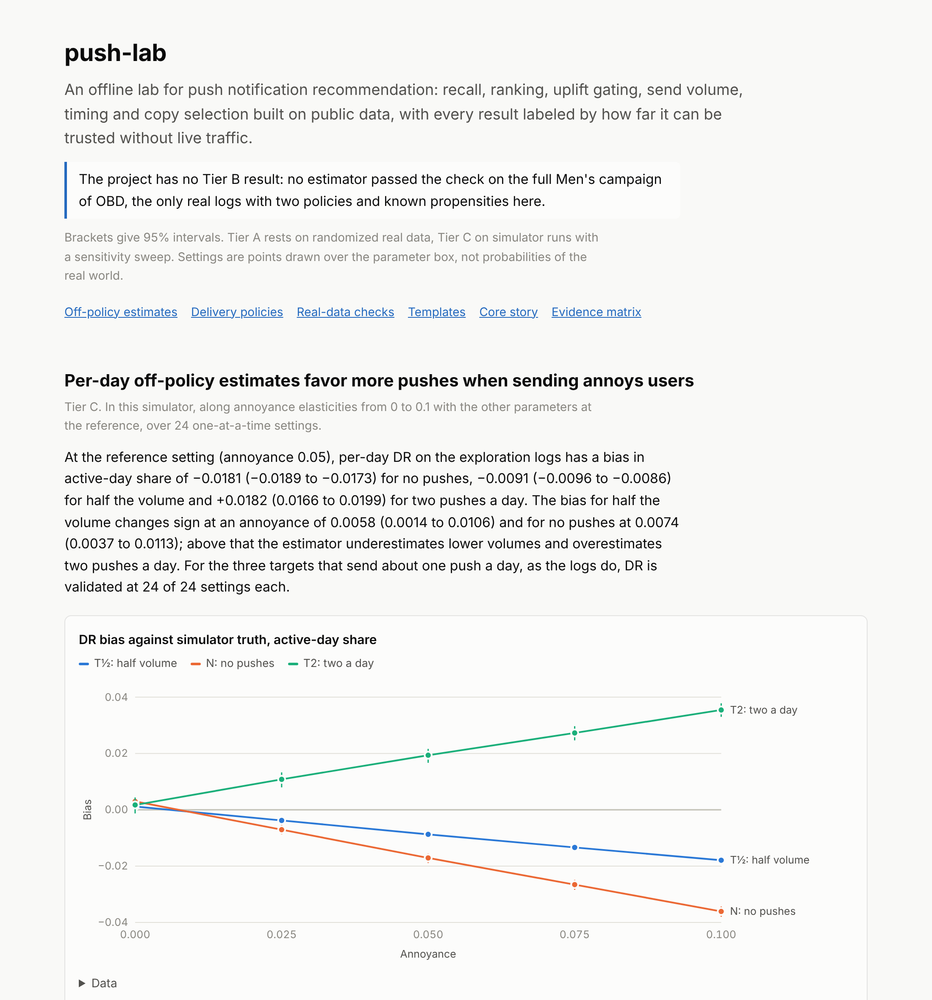

# push-lab

[](https://github.com/sHyanorn/push-lab/actions/workflows/ci.yml?query=branch%3Amain)

<!-- results:summary -->
An offline lab for push notification recommendation on public data, each result tiered by how far it can be trusted without live traffic: A, randomized real data; B, a validated off-policy estimate; C, simulator runs with a sensitivity sweep. Offline, on Duolingo's randomized notification logs, the project's template bandit raises two-hour session completion per notification by 0.00174 (0.00126 to 0.00221) from 0.12950 under uniform choice, and its recency penalty makes no detectable difference (Tier A, one notification given the logged histories). In the simulator, the state-carrying estimator SMIS favors one push a day over none on the exploration logs, the reverse of the truth, at 6 of the 8 settings, all those where pushes annoy users (Tier C). Volume, timing and long-term effects are measured only in the simulator, which cannot give real-world effect sizes.
<!-- /results:summary -->

[](https://shyanorn.github.io/push-lab/)

## Results

The numbers below and the [report](https://shyanorn.github.io/push-lab/) are generated from the committed results in [`results/`](results). Brackets give 95% intervals.

<!-- results:findings -->
| # | Finding | Evidence |
|---|---|---|
| 1 | On Duolingo's randomized practice-reminder logs, the offline results of Yancey and Settles replicate for 8 of 8 policies, a template sent within 1.5 days completes 1.4% (0.4% to 2.4%) less often than one not in the logged history, and the project's template bandit (RD) beats uniform choice by 0.00174 (0.00126 to 0.00221) in two-hour completion per notification, while its recency penalty adds nothing detectable, at +0.00029 (−0.00002 to 0.00061). | Tier A, one notification given the logged histories: policies scored on the 114,486,159 notifications of 18 test days; conservative intervals across days |
| 2 | In the simulator, per-day doubly robust (DR) estimates favor more pushes when sending annoys users: their bias for half the volume changes sign at an annoyance of 0.0058 (0.0014 to 0.0106). In a registered long-horizon study, no estimator recovers both volume differences at the reference on any of three logging designs; SMIS, which carries a state across days, favors one push a day over none on the project's exploration logs, the reverse of the truth, at 6 of the 8 settings, every one in which pushes annoy users. | Tier C: the registered reference run and a sweep of 24 settings on 5 one-at-a-time grids (annoyance 0 to 0.1); the long-horizon study at 8 settings |
| 3 | In the simulator, on the one-at-a-time grid, whether a daily push pays turns on two parameters only, annoyance and the base rate; at the reference setting it changes the daily active share by −2.3% (−2.4% to −2.2%) against no pushes. | Tier C: 64 Latin hypercube settings, the same settings without annoyance, and a one-at-a-time grid |
| 4 | On randomized real data, the fused fine ranker ranks random exposures worse than the two-tower score it refines (C2), the T-learner targets Criteo visits worse than a plain response model (U4), and on the full Men's campaign of the Open Bandit Dataset IPS estimates the BTS click rate at 0.891 (0.815 to 0.966) of its on-policy value and DR at 0.897 (0.824 to 0.975), so no estimator passed. | Tier A: KuaiRand random exposures, Hillstrom, Criteo and the Open Bandit Dataset |

The story registered in the [specification](docs/SPEC.md) holds only in part. Its central claim, that an uplift gate under a volume budget keeps more users active, does not hold as stated in the simulator (Tier C): at half volume the gate beats a daily push by +0.093 (0.052 to 0.136) active days per user on average, yet in only 43 of 64 main settings, losing in 19, and per-setting verdicts understate fit noise. The [report](https://shyanorn.github.io/push-lab/) gives each finding in full, with its sweep, post hoc analyses and limits, and the outcome of each item of the story.
<!-- /results:findings -->

<!-- results:evidence -->
| Tier | Evidence | Can support | Cannot support | Claims |
|---|---|---|---|---|
| A | Randomized real data: KuaiRand random exposures, Hillstrom, Criteo, Open Bandit Dataset, Duolingo notification logs | A component ranks or targets better in that domain; on the Open Bandit Dataset, how close an off-policy estimator comes to a known policy value; on the Duolingo logs, the value of one notification under a template policy given the logged histories | Push outside the Duolingo logs; volume fatigue or long-term effects | 15 |
| B | Off-policy estimate on real logs from an estimator first validated against a known answer | The value of a new policy within the support of the logging policy | Policies outside that support; long horizons | 0 |
| C | Simulator runs with a sensitivity sweep | Policy A beats B across a stated share of assumptions, or flips at a stated threshold | Real-world effect sizes | 53 |

The project has no Tier B result: no estimator passed the check on the full Men's campaign of OBD, the only real logs with two policies and known propensities here.
<!-- /results:evidence -->

## How it works

Ranking is evaluated on KuaiRand random exposures, and uplift models on Hillstrom and Criteo. A simulator built from KuaiRand tables runs delivery policies that differ in volume, gating, timing and copy, each over a sensitivity sweep. Copy templates are generated once, rated, and chosen by a bandit in the simulator. On Duolingo's notification logs the same policy rule is scored offline on Duolingo's own templates, after a check that the logged template choice was uniform and a replication of the paper's offline results. Off-policy estimators are checked against a known policy value on the Open Bandit Dataset, and in the simulator, including estimators that carry a state across days and two more logging designs. A report step reads `results/*.json` and writes the report page and the generated blocks of this README ([D049](docs/DECISIONS.md)).

Each result in the evidence matrix carries a tier, simulator results are shown only with their sensitivity sweep, and post hoc analyses are labeled. Pre-registrations and results are in [docs/DECISIONS.md](docs/DECISIONS.md); formulas, assumptions and parameter ranges in [docs/METHODS.md](docs/METHODS.md).

## Run it

Needs Python 3.14 and [uv](https://docs.astral.sh/uv/); everything runs on 4 CPU cores without a GPU.

```bash
uv sync
uv run pytest                                   # synthetic fixtures and the committed results; no downloads
uv run python -m push_lab.data.download         # datasets into data/raw, checksums verified
uv run python -m push_lab.data.download --only duolingo  # optional Duolingo logs, 9.35 GB; prepare takes the same flag
uv run python -m push_lab.data.prepare          # Parquet into data/processed
uv run python -m push_lab.report.build          # report in site/ and the README numbers
```

[docs/PIPELINE.md](docs/PIPELINE.md) lists every step of the pipeline with what it reads and writes. The [demo notebook](notebooks/demo.ipynb) recomputes the main summaries from the committed results.

## Limits

- Tier C results come from a simulator. They can show that one policy beats another across a stated share of assumptions; they cannot give real-world effect sizes. Settings are points drawn over the parameter box, not probabilities of the real world.
- Finding 2 does not show the size or sign of annoyance in a real app, or how parameters interact: the sweeps move one parameter at a time. The long-horizon study has one simulated world and 5,000 users, and reads its primary labels at the reference only.
- Crossing intervals cover user sampling with the grid's seeds fixed, not the interpolation or model-fit randomness (D034).
- The simulator does not read the copy, so its results say nothing about which text works.
- The Duolingo results cover one notification given the logged histories: a deployed policy would change later histories, and the logs show nothing about volume fatigue or long-term effects. With no user id, intervals are conservative across days and approximate within a day. They rest on uniform logged choice, the same kind of comparison as IPS on the uniform logs of OBD (below).
- The data of finding 4 are video feed, e-mail, ads and e-commerce recommendations, so finding 4 says nothing about push. The OBD ratio measures the estimators, not the value of any push policy.
- On the full Men's campaign of OBD, IPS and DR fall below the deployed policy's click rate under the registered intervals; the registered verdict stands, and no estimator is treated as validated (D063). The target is BTS with its fixed prior, which the deployed BTS was not, and the registered intervals resample impressions, which are not independent in these logs. These data do not show where the gap comes from; the [report](https://shyanorn.github.io/push-lab/#real-data) gives the post hoc block intervals and a separate registered study of the All and Women's campaigns (D063, D065).
- The results reproduce exactly on the machine that produced them, apart from a rare last-bit deviation in the two-tower fit and the few numbers that follow from it ([D062](docs/DECISIONS.md)). On other machines the fitted models and what follows from them differ ([D053](docs/DECISIONS.md)).

## Layout

```
src/push_lab/   data, recall, rank, uplift, sim, policy, creative, ope, report
results/        aggregated results (JSON)
data/creative/  generated copy and its manifest
notebooks/      demo notebook
docs/           specification, methods, decisions, tasks, pipeline
```

Code: [MIT](LICENSE). The datasets are not redistributed here and keep their own licenses; see [DATA_SOURCES.md](DATA_SOURCES.md).
