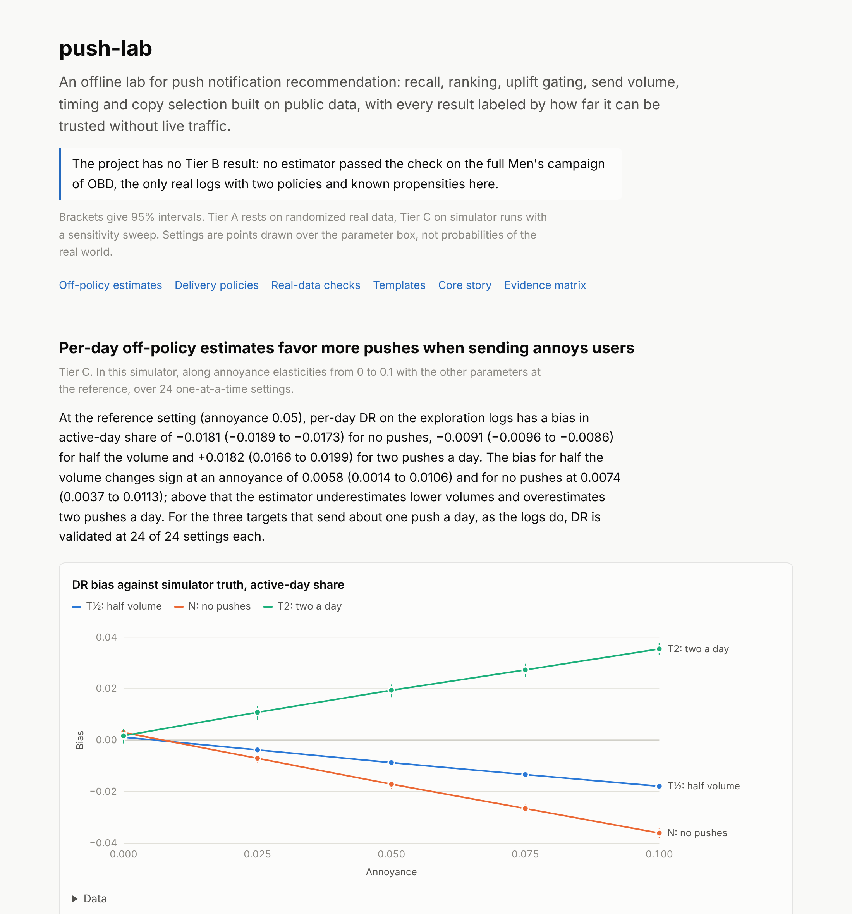

# push-lab

An offline lab for push notification recommendation: recall, ranking, uplift gating, send volume, timing and copy selection built on public data, with every result labeled by how far it can be trusted without live traffic.

[](https://shyanorn.github.io/push-lab/)

The [report](https://shyanorn.github.io/push-lab/) and the numbers below are generated from the committed results in [`results/`](results); the [demo notebook](notebooks/demo.ipynb) recomputes the main summaries from them. Brackets give 95% intervals.

## Evidence at a glance

<!-- results:evidence -->
| Tier | Evidence | Can support | Cannot support | Claims |
|---|---|---|---|---|
| A | Randomized real data: KuaiRand random exposures, Hillstrom, Criteo | A component ranks or targets better in that domain | Anything about push, fatigue or long-term effects | 9 |
| B | Off-policy estimate on real logs from an estimator first validated against a known answer | The value of a new policy within the support of the logging policy | Policies outside that support; long horizons | 0 |
| C | Simulator runs with a sensitivity sweep | Policy A beats B across a stated share of assumptions, or flips at a stated threshold | Real-world effect sizes | 40 |

The project has no Tier B result: no estimator passed the check on the full Men's campaign of OBD, the only real logs with two policies and known propensities here.
<!-- /results:evidence -->

Simulator results are always shown with their sensitivity sweep, and post hoc analyses are labeled. Pre-registrations and results are in [docs/DECISIONS.md](docs/DECISIONS.md); formulas, assumptions and parameter ranges in [docs/METHODS.md](docs/METHODS.md).

## Main findings

<!-- results:findings -->
### 1. In the simulator, per-day off-policy estimates favor more pushes when sending annoys users

*Tier C. In this simulator: the registered reference run, and a sweep of 24 settings on 5 one-at-a-time grids, of which the annoyance grid runs from 0 to 0.1 with the other parameters at the reference.*

In the registered reference run (annoyance 0.05; D045), per-day DR on the exploration logs has a bias in active-day share of −0.0181 (−0.0189 to −0.0173) for no pushes, −0.0091 (−0.0096 to −0.0086) for half the volume and +0.0182 (0.0166 to 0.0199) for two pushes a day. In the sweep (D048) the bias for half the volume changes sign at an annoyance of 0.0058 (0.0014 to 0.0106) and for no pushes at 0.0074 (0.0037 to 0.0113); above that the estimator underestimates lower volumes and overestimates two pushes a day. For the three targets that send about one push a day, as the logs do, DR is validated at 24 of 24 settings each. Fatigue, opt-out, return and novelty change no sign. *Post hoc:* At the reference of the sweep the simulator's truth puts no pushes ahead of one push a day by +0.0129 (0.0125 to 0.0133) in active-day share, while DR estimates −0.0044 (−0.0065 to −0.0023), the opposite sign. DR reverses this ordering at 23 of 24 settings and that of two a day against one at 22 of 24; its estimate of no pushes minus one a day stays between −0.0049 and −0.0036 along the annoyance grid while the truth moves from −0.0065 to +0.0315.

- **What it shows:** Per-day importance weights cannot see that recent volume lowers later organic visits, so in this simulator they favor higher volumes above the crossings, by an amount that grows with annoyance.
- **What it does not show:** The size or sign of annoyance in a real app, or how parameters interact: the sweep moves one parameter at a time.

### 2. In the simulator, whether a daily push pays turns on annoyance and the base rate

*Tier C. 64 Latin hypercube settings (main sweep), the same settings without annoyance, and a one-at-a-time grid.*

At the reference setting one push a day changes the daily active share by −2.3% (−2.4% to −2.2%) against no pushes. On the one-at-a-time grid it changes sign along two parameters only: it gains below an annoyance elasticity of 0.016 (0.015 to 0.017) and above a base-rate factor of 0.18 (0.17 to 0.19). Crossing intervals cover user sampling with the grid's seeds fixed, not the interpolation or model-fit randomness (D034). Across the 64 main settings, its lift is below the band of published program effects (0.07% to 0.5%) in 37, inside it in 2, above it in 21 and straddles it in 4. Under the registered reading, one push a day adds less activity than the smallest reported program change in most settings, and conclusions that rely on push benefits are weaker for it. At equal volume the decomposed gate G2 beats the response threshold S in most settings, while the T-learner gate G is worse on average (H1). Sending at each user's best slot shows no detectable difference from one fixed slot (H4; median per-setting half-width 0.011 active days), and is slightly worse on average without annoyance. Per-setting verdicts of H1 and H3 rest on one model fit and understate fit noise (D034).

| Id (main sweep) | Label | Sweep average | Wins / losses / neither |
|---|---|---|---|
| H1 | worse on average | −0.015 (−0.021 to −0.009) | 1 / 29 / 34 |
| H2 | beats in most sampled settings | +0.056 (0.048 to 0.064) | 64 / 0 / 0 |
| H3 | depends on the setting | +0.093 (0.052 to 0.136) | 43 / 19 / 2 |
| H4 | no detectable difference | 0.000 (−0.004 to 0.005) | 6 / 0 / 58 |

- **What it shows:** On the one-at-a-time grid, the sign of a daily push's effect is set by annoyance and the base rate. Over the sweep, at equal volume, a gate that scores open probability and baseline visits separately beats a response threshold, and a T-learner uplift gate does not.
- **What it does not show:** Real effect sizes. G2 assumes an open and an organic visit are independent given the features; this holds in the simulator by construction, so part of any G2 win comes from the simulator's structure.

### 3. Checks on randomized real data, two of them against expectation

*Tier A. KuaiRand random exposures, Hillstrom, Criteo and the Open Bandit Dataset.*

The fused fine ranker ranks random exposures worse than the two-tower score it refines (C2). On Criteo the T-learner targets visits worse than a plain response model (U4). On the full Men's campaign of the Open Bandit Dataset, IPS estimates the BTS click rate at 0.891 (0.815 to 0.966) of its on-policy value and DR at 0.897 (0.824 to 0.975), so no estimator passed and the project has no Tier B result. The target is BTS with its fixed production prior, which the deployed BTS was not. Post hoc, re-weighting to the BTS logs' own frequencies moves IPS to 0.917 (0.848 to 0.989).

- **What it shows:** A ranker fitted on logged impressions can rank random candidates worse than its retrieval score; where uplift grows with baseline response, a response threshold is a strong baseline; standard estimators fell short of a known policy value on real logs, with a target mismatch explaining part of the gap.
- **What it does not show:** Anything about push: the data are video feed, e-mail, ads and e-commerce recommendations. The OBD ratio measures the estimators, not the value of any push policy.
<!-- /results:findings -->

## Core story

[SPEC Section 3](docs/SPEC.md) states the story as a hypothesis registered before the simulations ran. How each part came out:

<!-- results:story -->
| Item | Outcome |
|---|---|
| Sending the top item to every user every day wins on clicks in week one | Holds at the reference, as a registered secondary result without a test (METHODS 12.7): week-one opens per user are 0.104 (0.099 to 0.109) for a daily push at the best slot and 0.056 (0.052 to 0.060) for the half-volume gate, in one model fit. |
| It loses users to fatigue and opt-outs by week four | Partly, in the simulator (F-N, D034). At the reference, a daily push leaves 3.89 (3.85 to 3.93) active days in week four against 4.05 (4.01 to 4.09) without pushes, and changes the daily active share by −2.3% (−2.4% to −2.2%). On the one-at-a-time grid the sign turns on annoyance (a gain below 0.016 (0.015 to 0.017)) and the base rate (a gain above 0.18 (0.17 to 0.19)), never on fatigue or opt-out. |
| An uplift gate under a volume budget, at each user's active slot, with a bandit choosing copy, sends fewer pushes and keeps more users active | Not as stated, in the simulator (H1 to H4, B1, B2; D034, D040). The T-learner gate loses to a response threshold at equal volume; the decomposed gate G2 wins, partly through the simulator's structure, which G2 assumes. At half volume the gate beats a daily push in 43 of 64 main settings and loses in 19 (per-setting verdicts understate fit noise), and wins in none without annoyance. The best slot adds nothing detectable. The bandit beats uniform templates on average; the recency penalty has no detectable effect. The simulator does not read the copy, so this says nothing about which text works. |
| The conclusion holds across most plausible settings, and the report shows where it flips | Partly (F-N, H3; D034). Flips are located for F-N along annoyance at 0.016 (0.015 to 0.017) and the base rate at 0.18 (0.17 to 0.19), and for H3 along annoyance at 0.013 (0.012 to 0.015); every other crossing of H1 to H4 is unresolved. Crossing intervals cover user sampling with the grid's seeds fixed, not the interpolation or model-fit randomness (D034). |
| Every number carries an evidence tier | Holds for the results in the evidence matrix, each Tier A or C with an interval or a verdict, and there is no Tier B result (D046). Counts of the generated copy and its rating are descriptive; registered verdicts later overturned are kept as history. |
<!-- /results:story -->

## Reproduce

Needs Python 3.14 and [uv](https://docs.astral.sh/uv/); everything runs on 4 CPU cores without a GPU.

```bash
uv sync
uv run pytest                                   # synthetic fixtures only
uv run python -m push_lab.data.download         # datasets into data/raw, checksums verified
uv run python -m push_lab.data.prepare          # Parquet into data/processed
uv run python -m push_lab.report.build          # report in site/ and the README numbers
```

Each step of the pipeline has its own module (`rank.evaluate`, `uplift.evaluate`, `sim.build`, `policy.sweep`, `policy.template_sweep`, `ope.obd`, `ope.simulator`, `ope.carryover`); measured run times are recorded in the decisions. The manual `reproduce` workflow runs the steps that work on synthetic fixtures, or reruns part of the pipeline on a small real sample and compares the numbers with the committed results ([D052](docs/DECISIONS.md)). The results reproduce exactly on the machine that produced them; on other machines the fitted models and what follows from them differ ([D053](docs/DECISIONS.md)).

## Layout

```
src/push_lab/   data, recall, rank, uplift, sim, policy, creative, ope, report
results/        aggregated results (JSON)
data/creative/  generated copy and its manifest
notebooks/      demo notebook
docs/           specification, methods, decisions, tasks
```

## License

Code: [MIT](LICENSE). The datasets are not redistributed here and keep their own licenses; see [DATA_SOURCES.md](DATA_SOURCES.md).
